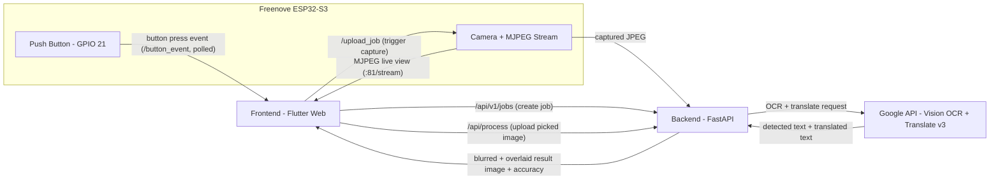

# Handheld OCR Translator

## 1. Introduction

Handheld OCR Translator is a physical camera-based tool that captures an image of printed text, detects and translates it, and renders the translated text to the connected device. Its purpose is to provide real-time, on-device-triggered translation of signs, labels, and documents without manually retyping text into a translation app. The current prototype (`wireless_mvp/`) is built around a **Freenove ESP32-S3** camera board that streams live video and captures stills over Wi-Fi to a FastAPI backend, controlled from a Flutter frontend or a physical push button wired to the board.

## 2. Technologies Used

| Category | Technology |
|---|---|
| **Languages** | Python, Dart, C++ |
| **APIs** | Google Cloud Vision API, Google Cloud Translation API v3 |
| **Backend Framework** | FastAPI |
| **Frontend Framework** | Flutter |
| **Firmware** | PlatformIO |
| **Hardware** | Freenove ESP32-S3-WROOM camera board, push button, slide switch, TPS61023 Boost Converter, 3.7 V Li-ion Battery |
| **Libraries / Packages** | `google-cloud-vision`, `google-cloud-translate`, `opencv-python` (`cv2`), `numpy`, `Pillow`, `pydantic`, `file_picker`, `shared_preferences` |

## 3. Functions and Features

- **Image capture**: Triggered three ways — the Flutter "Capture" button, the ESP32's physical push button (GPIO 21, debounced in firmware), or uploading an existing image file from disk. The ESP32 streams MJPEG live video so the frontend always shows a live preview before capture.
- **Image processing**: The backend Gaussian-blurs each detected text region to obscure the original text, then overlays the translated text, auto-fitting font size/line-wrapping to the region's bounding box and picking a script-appropriate font.
- **OCR**: Google Cloud Vision's returns word-level polygons, text, and per-word confidence. Adjacent words on the same line are merged into phrases before translation so phrases translate coherently rather than word-by-word.
- **Translation**: Google Cloud Translation API v3 translates the merged phrases in a single batched request.
- **Displayed OCR confidence score**: The "Accuracy" value shown in the UI is the **average per-word OCR confidence** reported by Google Vision for the captured image (not a measure of translation quality).

### Data flow



## 4. How to Use the Project

### Install & run the backend

```powershell
cd wireless_mvp
pip install -r backend/requirements.txt
python -m uvicorn backend.main:app --host 0.0.0.0 --port 8000 --reload
```

### Install & run the frontend

```powershell
cd wireless_mvp/frontend
flutter pub get
flutter run -d chrome
```

### Entering IP addresses in the frontend

Open the Settings dialog and fill in Backend and ESP32 camera URLs.

### Connecting the ESP32 to Wi-Fi

1. Copy [firmware/include/wifi_credentials.example.h](wireless_mvp/firmware/include/wifi_credentials.example.h) to `firmware/include/wifi_credentials.h` (gitignored) and fill in `WIFI_SSID`/`WIFI_PASSWORD`.
2. The serial monitor (115200 baud) prints the resulting IP address to enter into the frontend's ESP32 camera URL field.

## 5. Building Process

1. **`laptop_mvp`**: Started as a Tesseract/PaddleOCR OCR benchmarking tool evaluated against the ICDAR 2013 dataset, then grew into a Tkinter desktop GUI that captured frames from a webcam, ran PaddleOCR, and used the Google Cloud Translation API with a blur/overlay rendering step.
2. **Migration to Jetson Orin Nano**: To accelerate processing, I migrated the application to an NVIDIA Jetson Orin Nano, leveraging its dedicated AI and graphics hardware for edge computing. 
3. **Push-button implementation**: I soldered push button as well as GPIO pins to enable a physical activation of the system without having to interact with the UI.
4. **Migration to ESP32 (`wireless_mvp`)**: The project moved off the Jetson entirely onto a Freenove ESP32-S3 camera board for a fully wireless, handheld form factor. Since the ESP32 cannot run PaddleOCR locally, OCR moved from PaddleOCR to the cloud-based **Google Cloud Vision API**, and the GUI moved from Tkinter to a Flutter frontend talking to a new FastAPI backend over Wi-Fi, with the push button re-implemented in ESP32 firmware (GPIO 21) instead of Jetson GPIO, in addition to a power switch and 3.7V Li Battery.

## 6. Personal Learnings & Challenges

- **Image processing methods**: Getting the blur and overlay step to look right took more iteration than I expected as it required fitting translated text into the original text's bounding box while keeping it readable required dynamically scaling font size and line-wrapping rather than using a fixed font. 
- **OCR**: Moving from a locally-run model (PaddleOCR on CPU/Jetson GPU) to a cloud OCR API (Google Vision) simplified the embedded side enormously but introduced new considerations, including handling network latency/variance and designing a fallback path for when the primary API call fails.
- **User interface development**: Building the UI twice (once in Tkinter for the laptop/Jetson prototype and once in Flutter for the wireless version) taught me how much state management matters for a camera-driven app, and how useful it is to keep both frontends' layout/behavior conceptually mirrored to simplify the rewrite.
- **Soldering/electronics**: Wiring a physical push button to a microcontroller GPIO pin and getting reliable debounced input was a good reminder that small hardware details can cause problems that look like software bugs at first. It was critical to first plan the wiring before soldering it onto the board.

## 7. Future Improvements

- Mobile build of flutter frontend
- Automatic discovery of the backend/ESP32 addresses instead of manually entering IPs
- Offline/on-device OCR fallback for when the ESP32 has no internet access to reach Google APIs.
